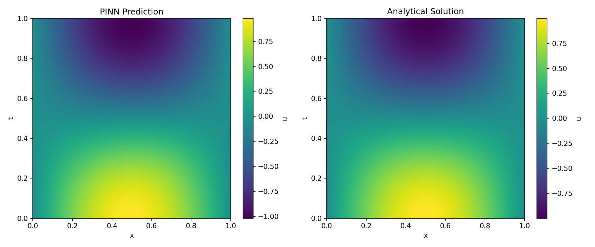
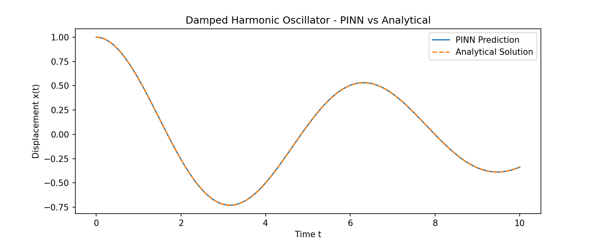
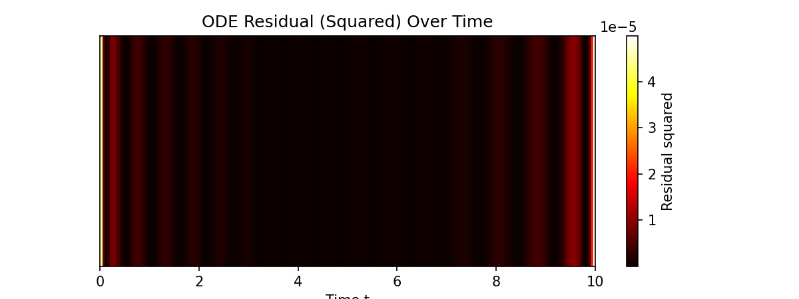

# PINNs for Classical PDEs

Physics-Informed Neural Networks (PINNs) use neural networks to approximate solutions of differential equations. They are trained by combining data or initial-boundary conditions with automatic differentiation of the governing physics equation.

This repository implements PINNs for three classical problems:

- **Heat equation:** models how temperature spreads through a medium over time.
- **Wave equation:** models displacement and wave propagation through space and time.
- **Damped harmonic oscillator:** models a mass-spring system that loses energy because of damping.

The examples demonstrate how PDE or ODE residual losses, initial conditions, and boundary conditions guide the neural network toward a physically consistent solution.

## Project structure

```text
pinns-classical-pdes/
├── README.md
├── requirements.txt
├── .gitignore
├── heat/
│   ├── heat_mlp.py
│   └── heat_resnet.py
├── wave/
│   └── wave_mlp.py
├── oscillator/
│   └── damped_oscillator.py
└── results/
```

## Setup

```powershell
cd pinns-classical-pdes
python -m venv .venv
.venv\Scripts\Activate.ps1
python -m pip install --upgrade pip
python -m pip install -r requirements.txt
```

## Run

```powershell
python heat/heat_mlp.py
python heat/heat_resnet.py
python wave/wave_mlp.py
python oscillator/damped_oscillator.py
```

Plots are saved in `results/`.

## Example results

### Heat equation

#### MLP


### Wave equation



### Damped oscillator





## Model notes

- The wave example is configured for a **physics-only PINN**. Set `USE_ANALYTICAL_DATA = True` in `wave/wave_mlp.py` to compare against the analytical solution at all grid points and create a data + physics hybrid.
- The oscillator example uses 500 collocation points, 20,000 Adam epochs, and L-BFGS refinement. The initial-condition loss has a 10× weight.
- The oscillator residual heatmap is labeled as an ODE residual, not a PDE residual.
