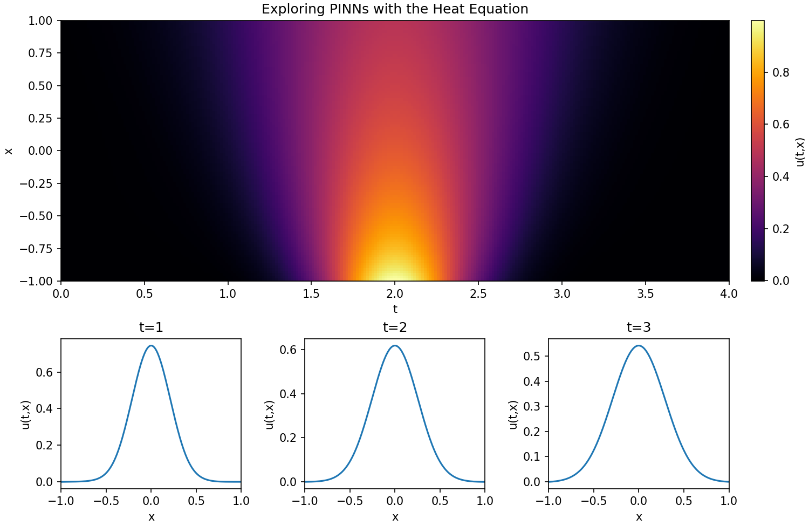

# PINNs for Classical PDEs

Physics-Informed Neural Networks (PINNs) use neural networks to approximate solutions of differential equations. They are trained by combining data or initial-boundary conditions with automatic differentiation of the governing physics equation.

This repository implements PINNs for three classical problems:

- **Heat equation:** models how temperature spreads through a medium over time.
- **Wave equation:** models displacement and wave propagation through space and time.
- **Damped harmonic oscillator:** models a mass-spring system that loses energy because of damping.

The examples demonstrate how PDE or ODE residual losses, initial conditions, and boundary conditions guide the neural network toward a physically consistent solution.

## Project structure

```text
pinns-classical-pdes/
├── README.md
├── requirements.txt
├── .gitignore
├── heat/
│   ├── heat_mlp.py
│   └── heat_resnet.py
├── wave/
│   └── wave_mlp.py
├── oscillator/
│   └── damped_oscillator.py
└── results/
```

## Setup

```powershell
cd pinns-classical-pdes
python -m venv .venv
.venv\Scripts\Activate.ps1
python -m pip install --upgrade pip
python -m pip install -r requirements.txt
```

## Run

```powershell
python heat/heat_mlp.py
python heat/heat_resnet.py
python wave/wave_mlp.py
python oscillator/damped_oscillator.py
```

Plots are saved in `results/`.

## Example results

### Heat equation

#### MLP



- The 2D heatmap shows temperature across position `x` and time `t`; the three 1D plots are temperature profiles at `t = 1`, `2`, and `3`.
- Initial condition: a centered Gaussian profile at `t = 0`.
- Boundary conditions: fixed zero temperature at `x = -1` and `x = 1`.
- Training: 2,000 Adam epochs with learning-rate scheduling on the PDE, initial-condition, and boundary losses.

#### ResidualNet

- This result uses the same heat equation, 2D heatmap, 1D time-slice views, and physical conditions as the MLP model.
- Its residual architecture uses six residual blocks with width 24.
- Training: 2,000 Adam epochs with the PDE, initial-condition, and boundary losses.

### Wave equation


- The 2D plots compare the physics-only PINN prediction with the analytical solution across `x` and `t`.
- PDE: `u_tt = c²u_xx`, with wave speed `c = 1`.
- Initial conditions: `u(x,0) = sin(pi*x)` and `u_t(x,0) = 0`.
- Boundary conditions: `u(0,t) = u(1,t) = 0`.
- Training: 10,000 Adam epochs on a 100×100 grid, with PDE, initial-condition, and boundary losses.
- Set `USE_ANALYTICAL_DATA = True` to add analytical solution data to the training loss.

### Damped oscillator


- The 1D plot compares displacement predicted by the PINN with the exact damped-oscillator solution over time.
- ODE: `x'' + 2*zeta*omega0*x' + omega0²*x = 0`, with `omega0 = 1` and `zeta = 0.1`.
- Initial conditions: `x(0) = 1` and `x'(0) = 0`.
- Training: 500 collocation points, 20,000 Adam epochs, a 10× initial-condition weight, then L-BFGS refinement.


- The 1D residual heatmap shows squared ODE error along the time axis; darker regions indicate smaller residuals.

## Model notes

- The wave example is configured for a **physics-only PINN**. Set `USE_ANALYTICAL_DATA = True` in `wave/wave_mlp.py` to compare against the analytical solution at all grid points and create a data + physics hybrid.
- The oscillator example uses 500 collocation points, 20,000 Adam epochs, and L-BFGS refinement. The initial-condition loss has a 10× weight.
- The oscillator residual heatmap is labeled as an ODE residual, not a PDE residual.
